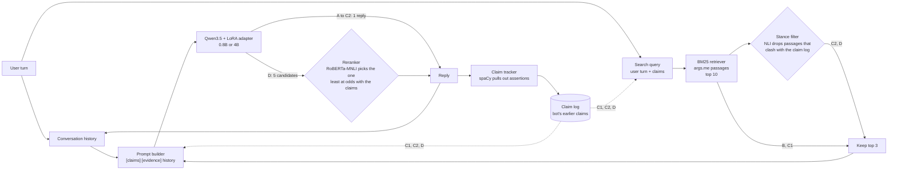
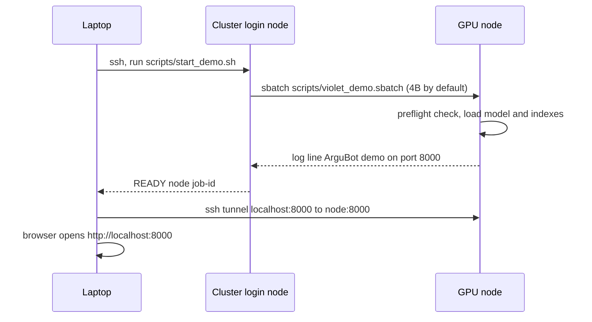
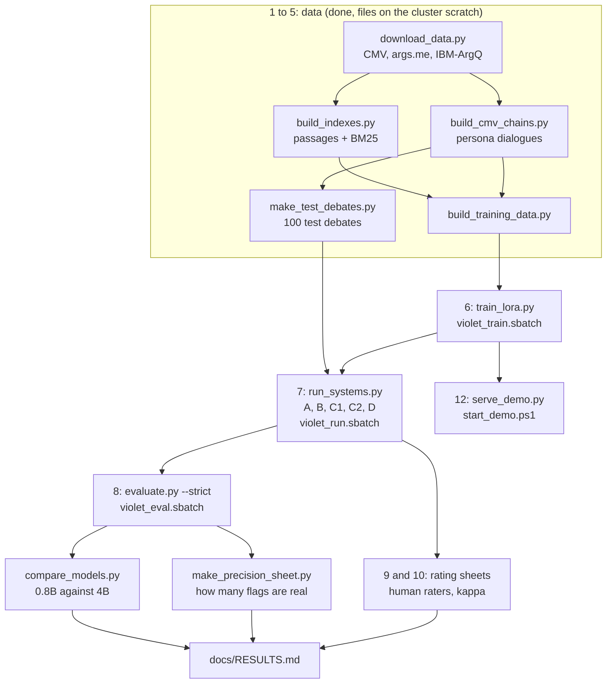

# ArguBot

A retrieval-augmented, consistency-tracking debate dialogue system. CS425, group G2T3.

ArguBot argues one side of a debate over several turns, grounds each reply in retrieved arguments, and keeps a log of its own earlier claims so it does not contradict itself. The hypothesis was that a generator conditioned on that claim log contradicts itself less than one that only sees the conversation history.

**Where the project is now:** everything in the proposal is built and evaluated. Two LoRA adapters are trained (Qwen3.5-0.8B-Base and Qwen3.5-4B-Base), all five systems have been run on the 100 test debates with both models, the automatic metrics, human ratings and a precision check of the metric are done, and the live demo starts with one command from a laptop. The full write-up is in `docs/RESULTS.md`; the short version is below.

## Results in brief

| | 0.8B | 4B |
| --- | --- | --- |
| Validation perplexity | 21.64 | 13.29 |
| Contradicting turns, B (retrieval) then C1 (+ claim log), strict metric | 24 then 17 of 200 | 17 then 9 of 200 |
| Is the claim log's drop significant? | No | No |
| Contradicting turns, D (+ reranking) | 8 of 200 | 1 of 200 (significant against C2) |
| Share of the metric's flags that are real (blind check) | 22% | 36% |

- The claim log points the right way in both models but the drop is not significant, and the human raters see no gain in keeping position either.
- Reranking (D) is the only significant step on the metric, but its replies get shorter and less assertive than the 10% guardrail allows.
- The 4B model fits the data much better and uses its evidence better in human ratings, but the claim log's effect is no larger with it.
- Real self-contradiction is rare for every system: most flags from the metric turn out to be false alarms when a person reads them.

## How it works

Every reply, in the batch runs and in the live demo, goes through `ArguBotPipeline.step` in `src/argubot/systems/pipeline.py`. The five systems are the same pipeline with parts switched on one at a time.



The claim tracker always listens, so the metrics can use it, but only C1, C2 and D are allowed to show the claim log to the model.

| System | Configuration | Question it answers |
| --- | --- | --- |
| A | Conversation history only | Where does the fine-tuned model land on its own? |
| B | A plus retrieved supporting arguments | Does retrieval make replies better grounded? |
| C1 | B plus the claim log | Does the claim log reduce contradictions? (the core test, C1 against B) |
| C2 | C1 plus the stance-consistency filter | Does removing clashing passages help further? |
| D | C2 plus 5-candidate reranking | Does choosing the most consistent reply help further? |

Each system adds exactly one component to the one before it, so any difference between neighbours has one cause.

## Quick start

```bash
python -m venv .venv && source .venv/bin/activate
pip install -e ".[dev]"
pytest                                  # all tests should pass
python scripts/run_systems.py --dummy   # fake components, checks the wiring end to end
python scripts/evaluate.py --dummy      # prints a results table (numbers are meaningless)
python scripts/serve_demo.py --dummy    # chat demo at http://127.0.0.1:8000 (fake replies)
```

For real runs also install the ML stack with `pip install -r requirements.txt` and `python -m spacy download en_core_web_sm`. Colab already has torch.

The `--dummy` runs use fake components and the toy data in `data/toy`. They only prove that the pieces fit together. Never put their numbers in the report.

## Running the live demo

The real models only fit on the SCIS GPU cluster, so the demo runs there and your browser reaches it through an SSH tunnel. One command on a Windows laptop does all of it (SMU VPN on when off campus):

```bash
powershell -ExecutionPolicy Bypass -File scripts\windows\start_demo.ps1
```



- Add `-Config configs/config.yaml` for the 0.8B model, or `-Port 8001` if 8000 is busy.
- If a demo job is already running, the script reuses it instead of starting another.
- Stop it afterwards so it stops holding the GPU: `ssh CS425G3@10.193.104.102 scancel -n argubot-demo`.
- Make sure no older demo (for example one started inside mynotebook) is still running on port 8000, or the new one cannot open the port.
- The manual way, and first-time cluster setup, are in `docs/RUN_ON_VIOLET.md`.

In the page you pick a system and argue with it; the claim log and the retrieved passages update next to every reply, and the header shows which model is answering. To choose which debates to show, `sbatch scripts/violet_demo_test.sbatch` plays eight scripted debates through both models several times and ranks them (`scripts/demo_rehearsal.py`). On the last rehearsal the best picks were minimum wage, school uniforms and nuclear power on 4B with system C1.

## Running the whole project

Run these from the repo root. This is also the draft of the report's "how to run" section, so keep it accurate.



1. `python scripts/download_data.py --all` downloads CMV, args.me and IBM-ArgQ (about 250 MB).
2. `python scripts/build_cmv_chains.py` builds persona dialogues, split by thread.
3. `python scripts/build_indexes.py` builds the passage files and the BM25 index (about 4 minutes).
4. `python scripts/build_training_data.py` fills the claim and evidence slots for training.
5. `python scripts/make_test_debates.py` picks the 100 scripted test debates.
6. `python scripts/train_lora.py --config <config>` trains the adapter (or use `notebooks/02_train.ipynb`). On the cluster use `sbatch scripts/violet_train.sbatch <config>`, which checkpoints, stops before the time limit and resubmits itself.
7. `python scripts/run_systems.py` runs A, B, C1, C2 and D on the test debates. Add `--limit 3 --out outputs/check3` for a quick check.
8. `python scripts/evaluate.py --human` computes contradiction rate, guardrails and bootstrap intervals against system A, with the real CMV replies as a reference row. Add `--baseline B` for the core test (C1 against B) and `--threshold 0.8` for the sensitivity check. Flagged contradiction pairs go to `outputs/results/flagged_<system>.jsonl`. `--strict` uses the strict metric instead (only real assertions against self-contained sentences on the same subject, both NLI directions agreeing, a different NLI model from the reranker's); its two cut-offs come from `python scripts/calibrate_strict_metric.py`, which uses no system output, and `python scripts/make_precision_sheet.py` builds a blinded sheet to measure how many of its flags are real.
9. `python scripts/make_rating_sheets.py` writes blinded sheets for the two human raters (the full procedure, with scoring rules and copying sheets to a laptop, is in `docs/HUMAN_RATINGS.md`).
10. `python scripts/score_ratings.py` checks the filled-in sheets and computes Cohen's kappa and per-system scores.
11. `python scripts/print_hparams.py` prints the hyperparameter table for the report.
12. `python scripts/serve_demo.py` opens the chat demo for the presentation. On the cluster use the one-step launcher above instead.

Steps 1 to 5 are already done: the test debates and training examples are committed, and the passages, indexes and trained adapter are on the SCIS cluster scratch. On the cluster, link them in (`docs/DATA_NOTES.md`, "Built files on the SCIS cluster" and "Trained LoRA adapter"), then run step 7 as a batch job with `sbatch scripts/violet_run.sbatch` (each system is saved as it finishes, and resubmitting carries on where it stopped). See `docs/RUN_ON_VIOLET.md` for first-time cluster setup.

## The 4B run

A second adapter on Qwen3.5-4B-Base, to see whether the claim log matters more with a stronger generator. `configs/config_4b.yaml` builds on `configs/config.yaml` and only changes the model, the precision (bf16), the epochs (1, because the 0.8B run overfit after its first), how the batch of 16 is split (2 x 8), and the output folders (`outputs/*_4b`), so it can never overwrite the 0.8B files. Pass `--config configs/config_4b.yaml` to any script, or set `CONFIG_PATH` in the notebooks. `configs/config_2b.yaml` is the same with Qwen3.5-2B-Base, in case 4B is too slow. The step by step plan, with the cluster commands and what to do when something goes wrong, is in `docs/UPGRADE_TO_4B.md`. Before any job, `python scripts/preflight.py --config <config> --stage <timing|train|run|eval|demo>` checks that everything it needs is there.

## What is finished and what is not

| Part | State |
| --- | --- |
| Prompt builder, slot blanking, reply-only labels, collator | Done and tested |
| Five-system pipeline, specs, seeds | Done and tested |
| Claim tracker (regex path and spaCy path) | Done, tuned by eye on 50 real CMV replies (`docs/DATA_NOTES.md`) |
| NLI scorer, reranker, both-direction check | Done; real RoBERTa-MNLI checked on 24 labelled pairs, threshold 0.5 kept (`notebooks/05_nli_check.ipynb`) |
| BM25 retriever, stance filter | Working |
| Contradiction rate, distinct-2, bootstrap, kappa, rating sheets, sheet checks | Done and tested |
| Chat demo (`scripts/serve_demo.py`, `notebooks/04_demo.ipynb`) | Done: runs either model on the cluster, shows which one in the header, starts in one step with `scripts/windows/start_demo.ps1` |
| Demo rehearsal | Done: `scripts/demo_rehearsal.py` ranks the scripted debates to show live (`scripts/violet_demo_test.sbatch`) |
| Thread split, comment cleaning, passage splitting | Done and tested |
| CMV persona extraction | Done and tested (9,642 dialogues from 2,734 of 3,051 threads) |
| args.me and IBM-ArgQ loading, passage files, fast BM25 index | Done and tested (1.2M args.me passages, 30k IBM-ArgQ) |
| Dense retrieval (MiniLM + FAISS) | Built over all 1.2M args.me passages (8 minutes on an L40S), stored on the cluster scratch, see `docs/DATA_NOTES.md`; the config still uses BM25 |
| IBM-ArgQ backup index and fallback | Built and tested, switched off (`retrieval.use_backup: false`), see `docs/DATA_NOTES.md` |
| Retrieval-stance test on the 71 motions | Done: `scripts/eval_retrieval_stance.py` (BM25 and dense), results in `docs/DATA_NOTES.md` |
| Stance alignment | Done as a tested utility, not wired into the pipeline |
| Training run | Done: full data, 3 epochs, validation perplexity 21.64 (lowest after epoch 1, see `docs/DATA_NOTES.md`); adapter on the cluster scratch (`docs/DATA_NOTES.md`). Trained without warmup (transformers 5.x dropped the setting; see `docs/UPGRADE_TO_4B.md`) |
| 4B run | Done: adapter trained (1 epoch, 1.6 h on an L40S, validation perplexity 13.29 against 21.64 for 0.8B, `docs/DATA_NOTES.md`), all five systems run on the 100 debates and evaluated (`docs/RESULTS.md`) |
| Notebooks | Done, see `notebooks/README.md` |
| Five-system run and evaluation | Done for both models: 0.8B in `outputs/transcripts_fix` (after the 30 Oct trim fix), 4B in `outputs/transcripts_4b`; results in `docs/RESULTS.md` |
| Human ratings | Done for both models: two raters, 20 debates x 5 systems each (`data/human_ratings/`, results in `docs/RESULTS.md`) |
| Precision of the strict metric | Done for both models: 87 (0.8B) and 66 (4B) flagged pairs labelled blind, 22% and 36% real (`data/precision_ratings/`, results in `docs/RESULTS.md`) |
| Training data builder | Done and tested, needs `build_indexes.py` first |
| Real download links | Done: `download_data.py --all` |

## Layout

```
configs/config.yaml     every setting, nothing hardcoded elsewhere (the 0.8B run)
configs/config_4b.yaml  the 4B run: only the model, precision and output folders differ (config_2b.yaml likewise)
src/argubot/            the package (prompt, claims, retrieval, nli, generate, systems, eval, data)
scripts/                one command per stage of the project, plus the violet_*.sbatch cluster jobs
scripts/windows/        start_demo.ps1, the one-step demo launcher for a Windows laptop
web/                    the chat demo: index.html is built from the React source in web/app/
                        (edit UI: cd web/app, npm install, npm run dev; then npm run build to update index.html)
tests/                  pytest suite, run it before every push
data/toy/               tiny files for the --dummy runs
docs/                   interface contract, data notes for the report, cluster guides
notebooks/              thin runners for Colab and the cluster (training, run + evaluate, demo, NLI check)
outputs/                transcripts, results and rating sheets (not committed)
```

Read `docs/INTERFACES.md` before you change anything that another lane calls.
